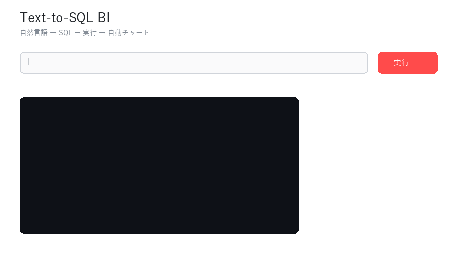

# 🗄️ Text-to-SQL BI — データに話しかけるBI

[](https://github.com/Cherie01234/text2sql-bi/actions/workflows/ci.yml)

## 概要

| 項目 | 内容 |
|---|---|
| 解く課題 | SQLを書かない利用者でも、自然言語の質問からデータを集計・可視化できるようにする。あわせて、LLMが生成するSQLの誤りや、データを書き換える操作を防ぐ |
| 手法 | 質問に関係するテーブル定義だけをLLMに渡すスキーマ検索（語の重なりによる軽量版）→ OpenRouter経由のLLMでDuckDB用のSQLを生成 → sqlglotで構文を検証しSELECT以外を拒否（読み取り専用接続と二重の防御）→ 実行エラー時はエラー内容をLLMに戻して作り直す（最大2回）→ 結果の表とグラフを表示 |
| 評価方法 | 実行結果の一致率（Execution Accuracy：生成SQLと正解SQLの結果を、行の順序を問わず比較）を、Northwindのサブセットで作った6問で計測し、複数のLLMを比較（[`eval/run_eval.py`](eval/run_eval.py)） |
| 結果 | `gpt-4o-mini`・`deepseek-v4-flash`・`gemini-2.5-flash-lite` の3モデルとも、各3回の実行すべてで 6/6（100%）、作り直しは0回（2026-11-01、結果は [`eval/results/`](eval/results/)）。6問と小規模で全モデルが満点になるため、モデル間の差を測るには問題を増やす必要がある |
| 評価からの知見 | 不一致の原因はモデルではなく、列構成の違いに敏感な指標の性質と、出力列を指定していない質問文にあると切り分けた。正解をモデル出力に合わせず、質問文と正解SQLで出力列を指定して評価データを直した（下記「評価で得られた知見」） |
| 使い方 | `.env` に `OPENROUTER_API_KEY` を設定 → `python data/build_northwind.py` → `streamlit run app.py`。評価は `python eval/run_eval.py --model <モデル名>`、テストは `pytest`（APIキー不要） |
| 開発 | 設計から個人で開発（開発にはAIエージェントを活用）。SQL検証のテスト（更新系SQL・複数文・構文不正の拒否）と GitHub Actions の CI を整備 |

---

自然言語の質問を **DuckDB の SQL に変換 → 実際に実行 → 結果テーブル＋自動チャート** で返す、対話型 BI デモです。
「学習済みモデルをラップしただけ」で終わらせず、**精度を数値で計測**し、**SQL が壊れない仕組み**を備えていることに重点を置いています。



> 質問: *「売上が最も高い商品トップ3を教えて」*
> → スキーマから関連テーブルを検索 → SQL 生成 → 構文検証 → 実行 → 棒グラフを自動描画

---

## ✨ 3つの工夫（このプロジェクトの肝）

| # | 仕組み | 何が嬉しいか | 実装 |
|---|---|---|---|
| 1 | **スキーマ RAG** | 質問に関連するテーブルだけをプロンプトに注入。大規模スキーマでもトークンが爆発しない | [`src/schema_indexer.py`](src/schema_indexer.py) |
| 2 | **静的バリデーション** | 生成 SQL を実行前に `sqlglot` で構文検証＋ SELECT 以外を機械的に拒否（read-only 接続と二重防御） | [`src/sql_validator.py`](src/sql_validator.py) |
| 3 | **自己修正ループ** | 検証/実行エラーをモデルに戻して自動リトライ。1発で通らない質問も復旧する | [`src/self_correct.py`](src/self_correct.py) |

## 📊 Execution Accuracy

結果セット一致（順序非依存）で計測する Text-to-SQL の標準指標です。`python eval/run_eval.py` で再現できます。

| Model | Execution Accuracy（3回の実行） | 平均リトライ |
|---|---|---|
| `openai/gpt-4o-mini` | 100% (6/6 ×3回) | 0.0 |
| `deepseek/deepseek-v4-flash` | 100% (6/6 ×3回) | 0.0 |
| `google/gemini-2.5-flash-lite` | 100% (6/6 ×3回) | 0.0 |

> 2026-11-01 に `--repeat 3` で計測（temperature=0）。各問の生成SQL・リトライ回数は [`eval/results/`](eval/results/) に保存しています。
> ベンチマークは [`eval/benchmark.jsonl`](eval/benchmark.jsonl)（質問↔正解SQL 6問）。6問では全モデルが満点で差がつかないため、本番では BIRD / Spider のサブセットに差し替えて計測する想定です。

### 評価で得られた知見（指標の限界とベンチ改善）

初回計測（2026-06-14）では全モデルが **5/6 (83%)** で、同一の問題（"最も注文を処理した従業員は？"）だけが落ちました。
FAIL の生成SQLを分析したところ、**3モデルともSQLは意味的に正しく**、原因はモデル側ではなく評価指標にありました:

- Execution Accuracy は**結果セットの完全一致**で判定するため、**列射影（projection）の違いに敏感**。
- 元の質問は出力列を指定しておらず、モデルが気を利かせて `employee_id` を追加したり名前を `CONCAT` したため、中身は正しくても列構成が正解と一致せず誤判定された。

> 2026-11-01 に修正前の q3 を各モデル3回ずつ再実行すると、`gpt-4o-mini` と `gemini-2.5-flash-lite` は3回とも、`deepseek-v4-flash` は3回中1回、列構成の違いで不一致になりました。不一致になった生成SQLも、すべて正解と同じ従業員を返しています（[`eval/results/q3_before_fix.json`](eval/results/q3_before_fix.json)）。

対策として、正解SQLをモデル出力に合わせるのではなく、**質問文で出力列を「姓のみ」と指定し、正解SQLもその指定どおりに直して**ベンチを改善し、全モデル **6/6 (100%)** に。
指標の特性を理解し、評価データ側の欠陥を切り分けて修正できることを示す一例です（[`eval/benchmark.jsonl`](eval/benchmark.jsonl) の `q3`）。

## 🏗️ アーキテクチャ

```
質問
  │
  ▼
schema_indexer ──(関連テーブルのDDL)──► sql_generator (OpenRouter LLM)
                                              │  生成SQL
                                              ▼
                                       sql_validator (sqlglot, SELECT限定)
                                              │  OK
                                              ▼
                                         executor (DuckDB, read-only)
                                              │  ┌── エラー ──► self_correct がフィードバックして再生成
                                              ▼  │
                                         insighter (自動チャート＋要約)
                                              ▼
                                         Streamlit UI
```

## 🚀 ローカル起動

```bash
pip install -r requirements.txt
cp .env.example .env          # OPENROUTER_API_KEY を設定
python data/build_northwind.py   # サンプルDB（Northwindサブセット）を生成
streamlit run app.py
```

評価とテスト:

```bash
python eval/run_eval.py --model openai/gpt-4o-mini   # 精度計測（要APIキー）
python eval/run_eval.py --model openai/gpt-4o-mini --repeat 3 --out eval/results/gpt-4o-mini.json   # 3回計測して結果を保存
pytest                                                # 決定的レイヤのテスト（APIキー不要）
```

## 🗂️ データ

定番 **Northwind** の小型サブセット（categories / products / customers / employees / orders / order_details）を
[`data/build_northwind.py`](data/build_northwind.py) でオフライン生成します（ダウンロード不要・決定的なので評価が安定）。

## 🧭 アップグレードの道筋（拡張ポイント）

- **スキーマRAGを埋め込み検索に**: 現在は軽量な語彙オーバーラップ。`sentence-transformers` + FAISS に差し替え可能（インターフェースは同形）。
- **DWHアダプタ**: `executor.py` を BigQuery / Snowflake 接続に差し替え。
- **MLOps化**: `run_eval.py` を CI（GitHub Actions）で回し、プロンプト改善ごとに精度を回帰チェック。
- **マルチモデル比較**: UI でモデルを切替え、精度×コストのトレードオフを可視化。

## 🛠️ 技術スタック

Python / Streamlit / DuckDB / sqlglot / OpenRouter (LLM) / Plotly / pandas
